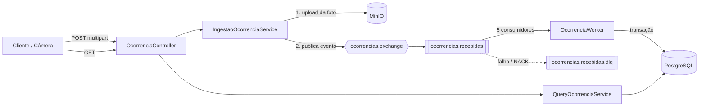

# CarBigData – Ingestão de Ocorrências com Fotos

Teste técnico Backend Java Sênior (dezembro/2025) — **Andrei Lima**.

Serviço de **ingestão de alta vazão** de ocorrências com foto (câmeras de trânsito / IoT).
A API recebe o dado + a imagem, responde rápido (`202 Accepted`) e deixa a gravação no banco
para um worker assíncrono, desacoplando o pico de entrada da velocidade de escrita.

## Stack

| Camada | Tecnologia |
|---|---|
| Linguagem / framework | Java 21, Spring Boot 4, Spring WebFlux (reativo) |
| Mensageria | RabbitMQ (exchange direct, filas duráveis, DLQ) |
| Banco | PostgreSQL 16 via R2DBC (acesso reativo) + Flyway (migrações) |
| Armazenamento de fotos | MinIO (compatível com S3) |
| Observabilidade | Spring Actuator + Micrometer/Prometheus |
| Testes | JUnit 5 + Testcontainers |

## Arquitetura



**Fluxo de escrita**
1. O controller valida o JSON (`dados`) e recebe a `foto` como parte multipart.
2. A foto é enviada ao MinIO com nome único (`timestamp_uuid.ext`).
3. Um evento `OcorrenciaRecebida` é publicado no RabbitMQ com *publisher confirms* e
   `mandatory=true` (mensagens não roteáveis voltam e são enviadas à DLQ).
4. A API responde `202 Accepted` — nada foi gravado no banco ainda.
5. O `OcorrenciaWorker` consome (ACK manual), e **em uma única transação** faz:
   upsert do cliente por CPF → insere endereço → insere ocorrência (`ATIVA`) → insere foto.
6. Erro no processamento → `NACK` sem requeue → mensagem vai para a DLQ.

**Organização do código** (estilo hexagonal simplificado)

```
domain/    model (records), event (OcorrenciaRecebida), enum de status
adapter/
  config/      RabbitQueueConfig, MinioConfig
  messaging/   OcorrenciaWorker (consumidor)
  repository/  repositórios R2DBC
  web/         controller, DTOs, serviços de ingestão/consulta e MinIO
```

## Como rodar

Requisitos: Docker e Docker Compose.

```bash
docker-compose up --build
```

| Serviço | Endereço |
|---|---|
| API | http://localhost:8080 |
| RabbitMQ (painel) | http://localhost:15672 (guest/guest) |
| MinIO (console) | http://localhost:9001 (minioadmin/minioadmin) |
| Métricas Prometheus | http://localhost:8080/actuator/prometheus |

Para rodar a aplicação fora do Docker (pela IDE), suba só `db`, `rabbitmq` e `minio`
com `docker-compose up db rabbitmq minio`; os padrões do `application.yml` apontam para `localhost`.
Cada endereço pode ser sobrescrito por variável de ambiente
(`SPRING_R2DBC_URL`, `SPRING_FLYWAY_URL`, `RABBITMQ_HOST`, `MINIO_URL`, `MINIO_ACCESS_KEY`, `MINIO_SECRET_KEY`).

## API

### `POST /ocorrencias` — registrar ocorrência
`multipart/form-data` com duas partes:
- `dados` (`application/json`): ver campos abaixo
- `foto`: arquivo de imagem (**obrigatória**; sem ela retorna `400`)

```bash
curl -X POST http://localhost:8080/ocorrencias \
  -F 'dados={
    "nmeCliente": "Andrei Lima",
    "dtaNascimento": "1990-01-01",
    "nroCpf": "12345678901",
    "nmeLogradouro": "Avenida Paulista",
    "nmeBairro": "Bela Vista",
    "nroCep": "01310100",
    "nmeCidade": "São Paulo",
    "nmeEstado": "SP",
    "dtaOcorrencia": "2025-12-10T10:00:00"
  };type=application/json' \
  -F 'foto=@/caminho/para/foto.jpg'
```

Validações: `nroCpf` com 11 dígitos, `nroCep` com 8 dígitos, `nmeEstado` com 2 letras maiúsculas,
`dtaNascimento` no passado, `dtaOcorrencia` no formato `yyyy-MM-ddTHH:mm:ss`.
Resposta: `202 Accepted` (sem corpo).

### `GET /ocorrencias` — lista paginada
Parâmetros: `page` (padrão 0), `size` (1–100, padrão 20), `status` (`ATIVA` | `FINALIZADA`, opcional).
Ordenado da mais recente para a mais antiga; a paginação é feita no banco.

### `GET /ocorrencias/stream` — todas as ocorrências em NDJSON
Streaming (`application/x-ndjson`) com backpressure: o cliente consome conforme processa,
sem carregar tudo em memória.

## Modelo de dados

`cliente` (CPF único) ← `ocorrencia` → `endereco`; `foto_ocorrencia` → `ocorrencia` (`ON DELETE CASCADE`).
Esquema completo em [`V1__initial_schema.sql`](src/main/resources/db/migration/V1__initial_schema.sql).

## Decisões de projeto

- **202 + fila** em vez de gravar direto: absorve picos de tráfego; o banco é escrito no ritmo do worker.
- **WebFlux/R2DBC**: poucas threads atendendo muitas conexões simultâneas, sem bloquear em I/O.
- **Upsert por CPF** (`ON CONFLICT`): mesmo cliente em ocorrências concorrentes não gera duplicata nem erro.
- **ACK manual + DLQ**: nenhuma mensagem é perdida silenciosamente; falhas ficam inspecionáveis.
- **Transação no worker**: se algum passo falhar, nada fica gravado pela metade.

## Limitações conhecidas / próximos passos

- As respostas de listagem trazem apenas código, data e status; falta o *join* com cliente, endereço e URL da foto.
- A foto é carregada inteira em memória antes do upload ao MinIO (adequado para imagens pequenas; para arquivos grandes, usar upload multipart em partes).
- Não há validação do conteúdo/tipo do arquivo (qualquer extensão é aceita) nem validação de dígitos verificadores do CPF.
- Credenciais padrão (`guest`, `minioadmin`, `postgres`) são apenas para desenvolvimento; em produção, usar segredos.
- O teste existente apenas carrega o contexto; faltam testes do fluxo ponta a ponta (API → fila → banco).
- `springdoc-openapi` 2.6.0 e `jackson-datatype-jsr310` 2.9.5 estão fixados no `pom.xml` e podem ser
  incompatíveis com o Spring Boot 4 — vale revisar as versões.
